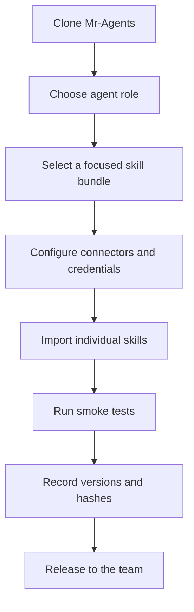

# Rareware Studio Manus Skills Guide

This guide explains how to import, configure, assign, use, update, and troubleshoot the shared skills in `Mr-Agents`.

## 1. What this repository contains

The collection has two layers:

| Layer | Count | Install guidance |
|---|---:|---|
| Top-level portable skills | 276 | Install these individually as Manus skills |
| Nested modules and reference skills | 68 | Keep them inside their parent skill; do not install them all independently |
| Total `SKILL.md` files | 344 | See `skills-manifest.json` for the exact inventory |

The nested layer includes reusable sub-skills and reference material. Some nested `SKILL.md` files are intentionally documentation-only and do not contain standalone frontmatter.

Every portable skill has a folder containing a `SKILL.md` file and may contain `scripts/`, `references/`, `templates/`, `formats/`, or other bundled resources.

## 2. Compatibility status

The portable top-level skills were normalized for the Manus skill format:

- `name` now matches the folder name and uses hyphen-case.
- `description` remains the primary trigger and routing field.
- Supported fields remain limited to `name`, `description`, `license`, `metadata`, and `allowed-tools`.
- Legacy fields such as `argument-hint`, `user-invocable`, `compatibility`, `version`, `model`, `hooks`, and `triggers` were preserved under `metadata.legacy-frontmatter` instead of being left as unsupported top-level keys.
- The 68 nested files were not flattened or rewritten.

The repository validator reports **0 failures across all 276 top-level portable skills**. Run the check from the repository root:

```bash
python3 /home/ubuntu/skills/skill-creator/scripts/quick_validate.py \
  --path skills/<skill-name>
```

Example:

```bash
python3 /home/ubuntu/skills/skill-creator/scripts/quick_validate.py \
  --path skills/data-analysis
```

## 3. Import one skill

Prefer importing only the skills an agent needs. A focused skill set produces better routing, lower context use, and fewer trigger collisions.

### Option A: Manus upload

1. Open the target Manus workspace's Skills or My Skills area.
2. Select one portable folder from `skills/`, or upload a `.skill` package.
3. Enable the skill for the target agent.
4. Run a small smoke-test prompt.
5. Record the enabled skill and required connectors in the team inventory.

A repository ZIP is not one monolithic skill. Each portable folder should be uploaded or packaged separately.

### Option B: Local user-skills directory

Where the Manus runtime supports local user skills, copy the selected skill folder into the workspace's user skill directory. Do not overwrite platform-managed system skills.

```bash
cp -a skills/data-analysis /path/to/your/user-skills/
cp -a skills/copywriting /path/to/your/user-skills/
```

Use the destination documented by that Manus environment. Do not assume that the managed `/home/ubuntu/skills/` directory is writable or persistent.

### Option C: Package a skill

Package a single skill with the official packager:

```bash
mkdir -p dist
python3 /home/ubuntu/skills/skill-creator/scripts/package_skill.py \
  skills/data-analysis dist/data-analysis.skill
```

Repeat this command for each selected skill. The resulting archive should contain `SKILL.md` at its root, not under an extra `skills/` directory.

## 4. Recommended team rollout

Use a staged rollout rather than enabling all 276 portable skills on every agent.



### Suggested bundles

| Agent role | Start with | Add only when needed |
|---|---|---|
| Full-stack engineering | `webdev`, `web-design-engineer`, `debugging-and-error-recovery`, `test-driven-development`, `git-workflow-and-versioning` | `supabase`, `api-designer`, `performance`, `observability-and-instrumentation` |
| Research and strategy | `deep-research`, `knowledge-synthesis`, `search-strategy`, `research-writing-skill` | `market-research-reports`, `customer-research`, `finance-pro-playbooks` |
| Marketing and content | `copywriting`, `blog-write`, `seo-aeo-best-practices`, `stop-slop`, `marketing-ideas` | `blog-rewrite`, `keyword-research`, `reddit-opportunity-research` |
| Video and media | `video-generation`, `captions-overlay`, `video-to-subtitle-summary`, `tts-prompter`, `music-prompter` | `seedance-prompter`, `kling-prompter`, model-specific media skills |
| Commerce and growth | `shopify-mcp`, `pricing-strategy`, `revops`, `sales-enablement` | `meta-ads-analyzer`, `instagram`, `account-research` |
| Documents and analysis | `office-documents`, `word-playbooks`, `excel-generator`, `data-analysis`, `validate-data` | `typst-pdf-maker`, `commercial-agreement-tabular-review` |
| Operations and coordination | `manus-tasks`, `manus-config`, `automation-and-scheduling`, `verification-before-completion` | `triggers`, `workflow`, `workflow-composer` |

These are starting points, not hard dependencies. Review each skill's description before enabling it.

## 5. Configure integrations separately

Skills provide instructions; they do not grant account access. Configure the required connector in the target Manus workspace before testing a skill.

| Capability | Typical skills | Separate setup |
|---|---|---|
| GitHub | `github-integration`, `make-repo-contribution`, `push-to-github` | GitHub connector and repository permissions |
| Google Workspace | `google-workspace-integration`, `gws-best-practices` | Google account authorization |
| Gmail and Calendar | `gmail`, `google-calendar` | Account selection and scopes |
| Shopify | `shopify-mcp`, `shopify-mcp`-related workflows | Shopify connector and store permissions |
| Canva | `canva-mcp`, `applying-brand-guidelines` | Canva account authorization |
| Instagram and Meta Ads | `instagram`, `meta-ads-analyzer` | Meta account selection and ad permissions |
| Web apps | `webdev`, `webdev-seo`, `web-design-engineer` | Web project/runtime configuration |
| Media generation | `video-generation`, `imagegen`, `acestep`, `tts-prompter` | Model availability, plan limits, and required inputs |
| Databases | `supabase`, `mongodb-schema-design`, `sql-queries` | Project credentials or connector authorization |

Never commit API keys, OAuth tokens, `.env` files containing values, private keys, or customer data. Store secrets through the target platform's secure configuration surface.

## 6. How agents should use skills

Skills are primarily selected from their descriptions. Write prompts that state the outcome, input, constraints, and output format.

Good prompt:

> Audit this Next.js page for WCAG 2.1 AA issues. Inspect keyboard navigation, focus order, semantics, labels, contrast, and reduced motion. Return a prioritized table with evidence and code-level fixes.

Weak prompt:

> Make it better.

For predictable results, use this structure:

```text
Goal: what must be produced
Context: product, audience, repository, or account
Inputs: files, URLs, data, or records
Constraints: permissions, format, deadline, safety limits
Output: exact artifact or response structure
Verification: how correctness should be checked
```

When several skills could apply, name the primary objective and let the agent use supporting skills. Avoid asking an agent to use every skill in the repository.

## 7. Agent configuration patterns

### Focused specialist

Use a small bundle for one repeatable job, such as `seo-audit` plus `data-analysis` and `validate-data`.

### General engineering agent

Use a broader but still bounded bundle: `webdev`, `spec-driven-development`, `writing-plans`, `test-driven-development`, `systematic-debugging`, `verification-before-completion`, and `git-workflow-and-versioning`.

### Research agent

Use `deep-research`, `search-strategy`, `knowledge-synthesis`, and the domain-specific research skill. Add connector skills only when the account is actually configured.

### Production agent

Separate planning from execution. Give the planning agent research and writing skills; give the execution agent only the tools and skills needed to modify files or call external services.

## 8. Smoke-test checklist

After importing a skill:

- Confirm the skill folder contains `SKILL.md` and all referenced bundled resources.
- Confirm the frontmatter validator passes.
- Run one read-only prompt that matches the description.
- Confirm the agent selects the expected skill.
- Confirm required connectors are authorized.
- Confirm the output format is usable by the next team member.
- Check that no credentials or private customer data entered the repository or output.
- Record the commit SHA and manifest hash in the team skill inventory.

## 9. Updating skills safely

Pin team agents to a reviewed commit instead of silently tracking a moving branch.

```bash
git clone https://github.com/arz282-ctrl/Mr-Agents.git
cd Mr-Agents
git checkout <reviewed-commit-or-branch>
```

Before upgrading:

1. Read the README and compatibility audit.
2. Compare `skills-manifest.json` with the currently deployed manifest.
3. Review changed `SKILL.md` files and any changed scripts.
4. Re-run validation for all imported skills.
5. Smoke-test connector-dependent skills in a non-production workspace.
6. Roll out to one agent first, then the rest of the team.

## 10. Troubleshooting

### The skill does not trigger

Check that the user prompt matches the skill description, that the skill is enabled for the agent, and that a conflicting skill is not routing the request first. Use a more explicit prompt naming the task and expected output.

### The validator reports an unexpected key

Use the normalized branch version. Supported top-level frontmatter is intentionally small. Put descriptive or historical fields under `metadata`; do not add arbitrary execution fields to the top level.

### A nested `SKILL.md` fails validation

Check its path. Files below a portable skill folder may be embedded modules or reference documents, not standalone skills. Install the parent folder and leave the nested file in place.

### A connector skill cannot act

The skill cannot authorize an account by itself. Enable the matching connector, choose the correct account when prompted, verify permissions, and retry with a read-only operation first.

### A script fails

Read the skill's referenced setup instructions, verify the runtime and dependencies, and avoid executing commands copied blindly from documentation. Keep generated artifacts and credentials outside the repository unless the skill explicitly requires safe templates.

## 11. Team operating rules

- Prefer the smallest skill bundle that can complete the task.
- Keep `SKILL.md` concise; move detailed references into `references/`.
- Treat descriptions as routing contracts: state what the skill does and when it should be used.
- Keep names lowercase and hyphenated.
- Preserve source licenses and attribution.
- Do not publish credentials or private account configuration.
- Review external-action skills before granting write permissions.
- Require verification evidence before declaring a task complete.
- Record changes in Git and use short-lived review branches.
