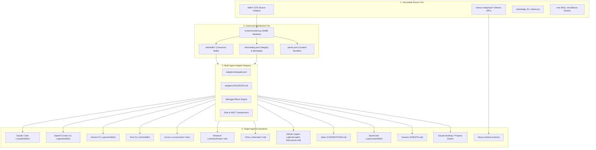

# Mr-Agents Universal Architecture (ARCHITECTURE.md)

## 1. Overview & Architectural Goals

The **Mr-Agents Universal Portability Architecture** expands a collection of 276 specialized Manus agent skills into an open, data-driven, multi-agent skills ecosystem installable across any AI developer assistant or coding environment—without altering or breaking existing Manus workflows.

---

## 2. The Three-Tier System

### Tier 1: Immutable Source Tier (Manus Compatibility)
- **Hard Rule 1 Compliance:** The `skills/` directory, `manus-ready/` zips, `repackage_for_manus.py`, and root `SKILL.md` are treated as read-only upstream assets.
- Legacy Manus users continue importing directly via GitHub (`https://github.com/arz282-ctrl/Mr-Agents`) or downloading modular ZIP archives from `manus-ready/zips/`.

### Tier 2: Canonical Distribution Tier
- **Validator (`tools/normalize.py`):** Pure Python standard-library tool that validates all 276 skills:
  - Enforces valid kebab-case folder names.
  - Ensures YAML frontmatter parses cleanly without third-party dependencies.
  - Validates `name` and `description` triggers.
  - Verifies that all relative markdown links outside code blocks resolve.
- **Portability Enrichment:** Appends standardized *Portability & Multi-Agent Execution Notes* to every normalized skill under `dist/skills/<name>/SKILL.md`, explaining tool substitutions and path resolutions for other agents.
- **Master Catalog (`dist/catalog.json`):** Full cryptographic inventory of every skill, including deterministic folder SHA-256 digests, detected capabilities, byte sizes, categories, and license identifiers.
- **Packs Configuration (`packs.json`):** Groups skills into functional bundles (`starter`, `research`, `webdev`, `marketing-seo`, `data`, `media`, `devops`, `qa-git`).

### Tier 3: Data-Driven Adapter & CLI Tier
- **Adapter Registry (`adapters/<agent>/`):** JSON declarations defining install modes, detection criteria, and paths. Adding a new agent requires zero CLI code modifications.
- **Four Distinct Install Modes:**
  1. `native-skill`: Direct copy of canonical skill payload to agent skill folder.
  2. `rule-file`: Conversion to agent's native rule format (e.g., Cursor `.mdc` or Windsurf `.md`).
  3. `instruction-index`: Injection of lightweight managed index blocks into standing instruction files (`AGENTS.md`, `CLAUDE.md`, `GEMINI.md`, `CONVENTIONS.md`, `.github/copilot-instructions.md`) with relative links to on-demand instructions.
  4. `command`: Export of portable knowledge packages for drag-and-drop web/desktop interfaces.

---

## 3. Cryptographic Integrity & Safety

1. **Deterministic Hashing:** Folder SHA-256 digests are computed over sorted file paths and byte streams.
2. **Pre-Write Verification:** The CLI checks SHA-256 against `dist/catalog.json` before writing any byte to the user's filesystem.
3. **Automated Safety Backups:** Existing user files are never overwritten without `--force`. When overwritten or updated, prior copies are automatically snapshotted into `.mr-agents/backup/<timestamp>/`.
4. **Exact Lockfile (`.mr-agents/lock.json`):** Tracks installed skills, versions, target paths, and scopes to ensure clean, deterministic uninstalls.
